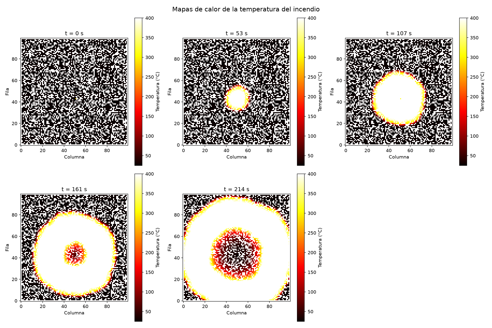

# Forest-Fire-Modeling-in-Mexico
Modelado y análisis de incendios forestales en México a partir de registros históricos de incendios.

# Datos
El conjunto de datos contiene registros históricos de incendios forestales en México.
Se pueden encontrar en el siguiente link: https://www.datos.gob.mx/dataset/incendios_forestales


Stefan-Boltzmann + cuadrado inverso + Beer-Lambert

## 1. Descripción general

Este proyecto simula cómo un incendio se propaga por un bosque representado como una **cuadrícula de 100 × 100 celdas** (cada celda mide 5 m, es decir, 500 m × 500 m en total). Un árbol en llamas sigue una curva de temperatura conocida (calentamiento sinusoidal y enfriamiento exponencial), **emite radiación térmica** según la ley de Stefan-Boltzmann y calienta a sus vecinos; cuando un vecino alcanza la temperatura de ignición, comienza a arder.

Es un modelo **estocástico-determinista**: la única componente aleatoria es la generación inicial del bosque (muestreo de Bernoulli con semilla fija); a partir de ahí la dinámica es completamente determinista, por lo que cada ejecución es reproducible. Es un **autómata celular** con estados discretos (`VACIO`, `FRIO`, `CALENTANDO`, `ARDIENDO`) cuya regla de transición se calcula con un balance físico de energía (radiación → calorimetría → umbral de ignición).

| Archivo | Lenguaje | Propósito |
|---|---|---|
| `incendio.c` | C | Motor de simulación: genera el bosque, integra el modelo físico en el tiempo y escribe los resultados en dos archivos CSV. |
| `visualizar.py` | Python (pandas + matplotlib + numpy) | Lee los CSV generados y produce dos gráficos: evolución de los estados y mapas de calor de temperatura. |

### Estructura del repositorio

```text
.
├── incendio.c                  # Motor de simulación
├── visualizar.py               # Visualización de resultados
├── README.md
└── (generados al ejecutar)
    ├── resultados_incendio.csv
    ├── resumen_incendio.csv
    ├── evolucion_estados.png
    └── mapas_calor.png
```

---

## 2. Teorías y modelos matemáticos

### 2.1 Generación del bosque — Muestreo de Bernoulli / Monte Carlo

**Idea.** Cada celda interior de la cuadrícula contiene un árbol de forma independiente con probabilidad $p$. Es un proceso de Bernoulli en cada celda, es decir, un muestreo de Monte Carlo del "bosque posible".

$$X_{ij} \sim \text{Bernoulli}(p), \qquad p = P(X_{ij}=1) = 0.6$$

En el código, se genera $u \sim U[0,1)$ con `rand()` y se coloca un árbol si $u > 0.40$:

$$\text{hay\_arbol}_{ij} = \begin{cases} 1 & \text{si } u_{ij} > 0.40 \\ 0 & \text{en otro caso} \end{cases}$$

El número esperado de árboles es

$$E[N_{\text{árboles}}] = p \cdot (N-2)^2 = 0.6 \cdot 98^2 \approx 5\,762$$

- **Parámetro en el código:** umbral `0.40` en `generar_vegetacion()`; `srand(42)` en `main()`; `N = 100`.
- **Bordes excluidos:** los bucles recorren `i, j ∈ [1, N-2]`, de modo que la primera y la última fila/columna quedan siempre vacías. Así se evitan **efectos de frontera** (celdas con menos vecinos que alteren artificialmente la propagación).
- **¿Por qué?** La semilla fija `srand(42)` hace que el mismo bosque se genere en cada ejecución, lo que garantiza **reproducibilidad**: cualquier cambio en los resultados se debe a un cambio de parámetros y no al azar.
- **Foco inicial:** el incendio se enciende manualmente en la celda `(fila, columna) = (43, 51)` mediante `iniciar_incendio()`.

---

### 2.2 Curva de temperatura del árbol en llamas

**Física / idea.** Un árbol que arde no mantiene una temperatura constante: se calienta hasta un pico y luego se apaga progresivamente. Se modela con dos fases enlazadas, donde $t$ es la **edad del fuego** (segundos transcurridos desde la ignición).

**Fase 1 — Calentamiento** ($0 \le t \le T_{\text{máx}}$): curva sinusoidal

$$T(t) = T_{\text{ignición}} + \left(T_{\text{máx}} - T_{\text{ignición}}\right) \cdot \sin\left(\frac{\pi \cdot t}{2 \cdot T_{\text{máx}}}\right)$$

**Fase 2 — Enfriamiento** ($t > T_{\text{máx}}$): decaimiento exponencial

$$T(t) = T_{\text{amb}} + \left(T_{\text{máx}} - T_{\text{amb}}\right) \cdot e^{-k \cdot (t - T_{\text{máx}})}$$

con la constante de decaimiento

$$k = \frac{-\ln\left(\dfrac{T_{\text{final}} - T_{\text{amb}}}{T_{\text{máx}} - T_{\text{amb}}}\right)}{T_{\text{máx}}}$$

> **Nota de notación:** en la fórmula de la fase 1, $T_{\text{máx}}$ aparece con dos significados: como **temperatura** pico (800 °C) y como **tiempo** en que se alcanza el pico (`TIEMPO_MAXIMO_S` = 600 s). En el código están separados: `T_MAXIMA_C` y `TIEMPO_MAXIMO_S`.

| Símbolo | Constante en el código | Valor |
|---|---|---|
| $T_{\text{ignición}}$ | `T_IGNICION_C` | $560.9278 - 273.15 \approx 287.78\,°\text{C}$ |
| $T_{\text{máx}}$ (temperatura) | `T_MAXIMA_C` | $800\,°\text{C}$ |
| $T_{\text{máx}}$ (tiempo del pico) | `TIEMPO_MAXIMO_S` | $600\,\text{s}$ |
| $T_{\text{amb}}$ | `T_AMBIENTE_C` | $25\,°\text{C}$ |
| $T_{\text{final}}$ | `T_FINAL_C` | $40\,°\text{C}$ |
| $k$ | calculada en `temperatura_arbol()` | $\approx 6.57 \times 10^{-3}\,\text{s}^{-1}$ |

**Continuidad en $t = T_{\text{máx}}$.** Al evaluar ambas fases en el instante del pico:

- Fase 1: $\sin\left(\frac{\pi}{2}\right) = 1 \Rightarrow T = T_{\text{ignición}} + (T_{\text{máx}} - T_{\text{ignición}}) = T_{\text{máx}}$
- Fase 2: $e^{0} = 1 \Rightarrow T = T_{\text{amb}} + (T_{\text{máx}} - T_{\text{amb}}) = T_{\text{máx}}$

Ambas ramas coinciden en $T_{\text{máx}}$, así que la curva es **continua** (clase $C^0$). Además, el seno tiene pendiente cero en el pico, por lo que la transición es suave por la izquierda. Por construcción, $k$ garantiza que $T(2\,T_{\text{máx}}) = T_{\text{final}}$, es decir, el árbol llega a 40 °C exactamente 600 s después del pico.

```text
 T (°C)
  800 |            ***                  Fase 1: seno
      |         **     **               Fase 2: exponencial
      |       *           *
      |     *               *
  288 |   *                   *
      |                          *  *
   40 |                                 *  *  *  *
   25 +---+----------+----------+----------+------> t (s)
      0          600 (pico)   1200        1500
```

- **¿Por qué?** Reproduce de forma sencilla el ciclo real de un incendio de copa: ignición rápida, pico de intensidad y extinción gradual, con muy pocos parámetros.

---

### 2.3 Ley de Stefan-Boltzmann (emisión térmica)

**Física.** Todo cuerpo a temperatura absoluta $T$ emite radiación electromagnética. La potencia emitida por unidad de área de un cuerpo negro es

$$E = \sigma \cdot T^4 \quad [\text{W/m}^2]$$

con $\sigma = 5.6704 \times 10^{-8}\ \text{W} \cdot \text{m}^{-2} \cdot \text{K}^{-4}$.

- **Parámetro en el código:** `SIGMA = 5.670400e-8`; funciones `radiacion_emitida()` y (internamente) `radiacion_recibida()`.
- **La temperatura DEBE estar en Kelvin.** El código trabaja en °C y convierte con `temperatura_k = temperatura_c + 273.15` antes de elevar a la cuarta potencia.
- **¿Por qué?** La dependencia en $T^4$ hace que el árbol emita muchísima más energía en el pico que al inicio de la ignición. Ejemplo (aprox.): a $287.78\,°\text{C}$ ($\approx 561$ K) $E \approx 5.6\ \text{kW/m}^2$; a $800\,°\text{C}$ ($\approx 1073$ K) $E \approx 75.2\ \text{kW/m}^2$, unas 13 veces más.

---

### 2.4 Atenuación por distancia — Cuadrado inverso + Beer-Lambert

**Física.** La radiación emitida por el árbol en llamas se dispersa en el espacio y además la atmósfera absorbe parte de ella. Se combinan dos factores:

- **Factor geométrico** (ley del cuadrado inverso), donde $R$ es el radio de la copa y $d$ la distancia entre centros:

$$F_{\text{geo}} = \frac{R^2}{d^2}$$

- **Atenuación atmosférica** (ley de Beer-Lambert), con coeficiente de extinción $\alpha$:

$$F_{\text{atm}} = e^{-\alpha d}$$

**Flujo recibido combinado:**

$$F_{\text{recibido}}(d) = \sigma T^4 \cdot \frac{R^2}{d^2} \cdot e^{-\alpha d}$$

- **Parámetros en el código:** `RADIO_ARBOL_M = 2.0` m, `ALPHA = 0.05` m⁻¹ (en `radiacion_recibida()`).
- **¿Por qué?** El cuadrado inverso domina a corta distancia y la exponencial a larga distancia. Un $\alpha$ pequeño (0.05) permite que la radiación llegue más lejos, favoreciendo la propagación. La función devuelve 0 si $d \le 0$ o $\alpha < 0$ para evitar singularidades.

**Efecto combinado de la distancia** (para un emisor en $800\,°\text{C}$, valores aproximados):

| $d$ (m) | $F_{\text{geo}}$ | $F_{\text{atm}}$ | $F_{\text{recibido}}$ (W/m²) |
|---|---|---|---|
| 5 | 0.160 | 0.779 | ≈ 9 370 |
| 10 | 0.040 | 0.607 | ≈ 1 830 |
| 20 | 0.010 | 0.368 | ≈ 277 |

---

### 2.5 Potencia y energía interceptada

**Física.** El árbol receptor intercepta el flujo sobre su **área frontal**, un disco de radio $R$. La potencia interceptada y la energía acumulada durante un paso de tiempo $\Delta t$ son:

$$P = F_{\text{recibido}} \cdot \pi R^2 \qquad Q = P \cdot \Delta t$$

- **Parámetros en el código:** `area_frontal = PI * RADIO_ARBOL_M²` (≈ 12.57 m²) en `potencia_interceptada()`; `intervalo_s = DT` en `energia_absorbida()`.
- **Superposición:** un árbol puede recibir radiación de varios vecinos ardiendo a la vez. La energía total se acumula sumando las contribuciones de todos los emisores $e$ dentro de la vecindad:

$$Q_{\text{total}} = \sum_{e} \sigma T_e^4 \cdot \frac{R^2}{d_e^2} \cdot e^{-\alpha d_e} \cdot \pi R^2 \cdot \Delta t$$

- **¿Por qué?** Convierte un flujo (W/m²) en energía en julios (J), que es lo que necesita la calorimetría del siguiente paso.

---

### 2.6 Calorimetría (calentamiento del árbol receptor)

**Física.** La energía absorbida eleva la temperatura de la copa del árbol según la ecuación fundamental de la calorimetría:

$$Q = m \cdot c \cdot \Delta T \quad \Rightarrow \quad \Delta T = \frac{Q}{m \cdot c}$$

- **Parámetros en el código:** `MASA_COPA_KG = 2.0` kg (copa seca) y `CALOR_ESPECIFICO_J_KG_K = 1700.0` J/(kg·K). Por tanto $m \cdot c = 3400\ \text{J/K}$ (en `actualizar_temperatura()`).
- **Ejemplo (aprox.):** un vecino a 5 m del emisor en su pico ($800\,°\text{C}$) recibe $P \approx 118\ \text{kW}$ y, en un paso de 7 s, $Q \approx 824\ \text{kJ}$, lo que equivale a $\Delta T \approx 242\,°\text{C}$ por paso. A 20 m, $\Delta T \approx 7\,°\text{C}$ por paso.
- **¿Por qué?** Es el puente entre la energía radiante y la temperatura del receptor, que decide si este alcanza o no el umbral de ignición. Una masa pequeña (hojas secas) hace que la copa se caliente rápido.

---

### 2.7 Integración numérica — Euler explícito con doble buffer

**Esquema.** La temperatura de cada árbol receptor se actualiza con el método de **Euler explícito** (primer orden): la tasa de calentamiento se evalúa con el estado del paso $n$ y se aplica durante $\Delta t$:

$$T_{ij}^{\,n+1} = T_{ij}^{\,n} + \frac{Q_{ij}^{\,n}}{m \cdot c}, \qquad Q_{ij}^{\,n} = \Delta t \cdot \sum_{e} P_e^{\,n}$$

**Doble buffer.** Cada celda guarda dos temperaturas: `temperatura_c` (estado actual, paso $n$) y `temperatura_siguiente_c` (estado futuro, paso $n+1$). Un paso del autómata se divide en tres fases:

```text
 Paso n                                                    Paso n+1
 ┌──────────────────┐   ┌─────────────────────────┐   ┌────────────────────────┐
 │ 1. Acumular      │   │ 2. Calcular             │   │ 3. Confirmar:          │
 │    energia[i][j] │──►│    temperatura_siguiente│──►│    temperatura_c ←     │
 │    (solo lectura │   │    _c = T + Q/(m·c)     │   │    temperatura_siguiente│
 │    del estado n) │   │                         │   │    _c  y actualizar    │
 └──────────────────┘   └─────────────────────────┘   │    estados / ignición  │
                                                       └────────────────────────┘
```

- **¿Por qué el doble buffer?** Toda la energía del paso $n$ se calcula a partir del estado **congelado** del paso $n$, y solo después se confirman los nuevos valores y las nuevas igniciones. Así el resultado **no depende del orden de recorrido** de la cuadrícula (filas, columnas o cualquier otro): una ignición ocurrida en este paso no puede influir en otras celdas hasta el siguiente paso. Esto mantiene la actualización **síncrona** y estable, como exige un autómata celular.
- **Emisores:** la temperatura de los árboles que arden **no se integra**, sino que se evalúa de forma analítica con la curva de la sección 2.2 según su edad.
- **Parámetros:** `DT = 7.0` s, `TIEMPO_TOTAL_S = 1500.0` s, de donde

$$N_{\text{iter}} = \left\lfloor \frac{T_{\text{total}}}{\Delta t} \right\rfloor = \left\lfloor \frac{1500}{7} \right\rfloor = 214 \ \text{iteraciones} \quad (\approx 1\,498\ \text{s simulados})$$

---

### 2.8 Autómata celular con estados

Cada celda está en uno de cuatro estados (`enum Estado`):

| Código | Estado | Significado |
|---|---|---|
| 0 | `VACIO` | Celda sin árbol. |
| 1 | `FRIO` | Árbol a temperatura ambiente. |
| 2 | `CALENTANDO` | Árbol que ya recibió energía pero sin llegar a la ignición. |
| 3 | `ARDIENDO` | Árbol en llamas (**estado absorbente**: nunca vuelve a otro estado). |

**Diagrama de transiciones:**

```text
   VACIO  (sin árbol: permanece así siempre)

   FRIO ───────────► CALENTANDO ───────────► ARDIENDO  (absorbente)
     │        T > T_amb + 0.1 °C       T ≥ T_ignición        ▲
     │                                                       │
     └───────────────────────────────────────────────────────┘
                     T ≥ T_ignición (ignición directa)
```

**Reglas de transición** (aplicadas en `actualizar_estados_ignicion()`):

| Condición sobre la temperatura del árbol | Nuevo estado |
|---|---|
| $T \ge T_{\text{ignición}} \approx 287.78\,°\text{C}$ | `ARDIENDO` (se guarda `tiempo_ignicion_s = paso`) |
| $T_{\text{amb}} + 0.1\,°\text{C} < T < T_{\text{ignición}}$ | `CALENTANDO` |
| $T \le T_{\text{amb}} + 0.1\,°\text{C}$ | `FRIO` |

**Vecindad.** Cada árbol en llamas influye sobre los árboles dentro de una **vecindad de Chebyshev de radio 4 celdas** (ventana de $9 \times 9$ celdas, 80 vecinos):

$$\mathcal{V}(i,j) = \{(i+d_i,\, j+d_j) : \max(|d_i|, |d_j|) \le 4,\ (d_i, d_j) \ne (0,0)\}$$

El alcance es de 4 celdas × 5 m = **20 m** en horizontal y vertical (hasta $\approx 28.3$ m en las esquinas de la ventana). Solo reciben energía los árboles que no están ardiendo.

- **¿Por qué?** Separar el estado discreto de la temperatura continua permite aplicar reglas simples y contar poblaciones de cada estado. El radio 4 (ampliado desde 2) da al frente de fuego más alcance, lo que facilita la propagación a través de huecos del bosque.

---

### 2.9 Distancia euclidiana en la cuadrícula

**Idea.** La distancia entre dos árboles se calcula con la métrica euclidiana sobre los índices de celda y se escala por el tamaño físico de la celda:

$$d = \Delta_{\text{celda}} \cdot \sqrt{\Delta_i^2 + \Delta_j^2}$$

- **Parámetro en el código:** `TAM_CELDA_M = 5.0` m, en `distancia_arboles()`.
- **Ejemplos:** vecino ortogonal ($\Delta_i=1, \Delta_j=0$): $d = 5$ m. Vecino diagonal ($\Delta_i = \Delta_j = 1$): $d = 5\sqrt{2} \approx 7.07$ m.
- **¿Por qué?** La **vecindad** es cuadrada (Chebyshev), pero la **física** usa distancia real (euclidiana): un vecino diagonal está más lejos que uno ortogonal, y por eso recibe menos radiación.

---

## 3. Arquitectura del código

### Flujo de `main()`

```text
main()
 │
 ├─ srand(42)
 ├─ inicializar_bosque()        ← todo VACIO, T = T_amb
 ├─ generar_vegetacion()        ← Bernoulli (p = 0.6), sin bordes
 ├─ iniciar_incendio(43, 51)    ← foco inicial: ARDIENDO
 ├─ fopen(...) + encabezados CSV
 ├─ guardar_resultados(paso 0)
 ├─ guardar_resumen(paso 0)
 │
 └─ for paso = 1 .. 214
      │
      ├─ simular_paso()
      │    ├─ calcular_energia_recibida()
      │    │     ├─ temperatura_arbol()        ← curva del emisor (sección 2.2)
      │    │     ├─ distancia_arboles()        ← sección 2.9
      │    │     └─ energia_absorbida()
      │    │           └─ potencia_interceptada()
      │    │                 └─ radiacion_recibida()   ← secciones 2.3 y 2.4
      │    ├─ calcular_temperaturas_siguientes()
      │    │     └─ actualizar_temperatura()   ← calorimetría (sección 2.6)
      │    └─ actualizar_estados_ignicion()    ← transiciones (sección 2.8)
      │
      ├─ actualizar temperatura de árboles ARDIENDO (temperatura_arbol)
      ├─ guardar_resultados(paso)
      └─ guardar_resumen(paso)
```

### Funciones principales de `incendio.c`

| Función | Descripción |
|---|---|
| `temperatura_arbol(t)` | Curva de temperatura de un árbol ardiendo según su edad (seno + exponencial). |
| `radiacion_emitida(T)` | Flujo de Stefan-Boltzmann $\sigma T^4$ (auxiliar; no es invocada por el flujo principal, que usa `radiacion_recibida`). |
| `radiacion_recibida(T, d, α)` | Flujo que llega a distancia $d$ con cuadrado inverso y Beer-Lambert. |
| `potencia_interceptada(T, d, α)` | Potencia sobre el área frontal del receptor. |
| `energia_absorbida(T, d, α, Δt)` | Energía en julios recibida durante un paso. |
| `distancia_arboles(i₁, j₁, i₂, j₂)` | Distancia euclidiana en metros entre dos celdas. |
| `actualizar_temperatura(T, Q, m, c)` | Aplica $\Delta T = Q/(m c)$. |
| `inicializar_bosque()` | Deja todas las celdas vacías y a temperatura ambiente. |
| `generar_vegetacion()` | Coloca árboles con muestreo de Bernoulli en el interior de la cuadrícula. |
| `iniciar_incendio(i, j)` | Marca una celda como `ARDIENDO` con temperatura de ignición. |
| `calcular_energia_recibida()` | Recorre los emisores y acumula la energía sobre sus vecinos (radio 4). |
| `calcular_temperaturas_siguientes()` | Escribe `temperatura_siguiente_c` (Euler explícito). |
| `actualizar_estados_ignicion()` | Confirma las temperaturas, aplica las reglas de transición y cuenta nuevas igniciones. |
| `simular_paso()` | Orquesta un paso completo (las tres fases anteriores). |
| `contar_arboles()` / `contar_estados()` | Estadísticas del bosque. |
| `guardar_resultados()` / `guardar_resumen()` | Escritura de los CSV. |

---

## 4. Salidas generadas

| Archivo | Tipo | Contenido |
|---|---|---|
| `resultados_incendio.csv` | CSV | Estado completo de la cuadrícula en cada paso (una fila por celda y paso). Columnas: `tiempo_s` (índice del paso), `fila`, `columna`, `estado` (0–3), `temperatura_c`, `tiempo_ignicion_s` (paso de ignición, `-1` si nunca ardió). |
| `resumen_incendio.csv` | CSV | Conteo de celdas por estado en cada paso. Columnas: `tiempo_s` (segundos reales $= \text{paso} \cdot \Delta t$), `vacios`, `frios`, `calentando`, `ardiendo`. |
| `evolucion_estados.png` | Imagen | Gráfico de líneas de la evolución temporal del bosque. |
| `mapas_calor.png` | Imagen | Panel de mapas de calor de la temperatura en instantes representativos. |

>  `resultados_incendio.csv` contiene $215 \times 10\,000 \approx 2.15$ millones de filas (decenas de MB). Se recomienda agregarlo al `.gitignore` en lugar de subirlo a GitHub.

### Qué muestra cada gráfico de `visualizar.py`

- **`evolucion_estados.png`** — Lee `resumen_incendio.csv` y grafica, frente al tiempo, el número de árboles **fríos** (azul), **calentándose** (naranja) y **ardiendo** (rojo). Permite ver la dinámica global: cuándo se dispara el incendio, a qué ritmo se propaga y cuántos árboles quedan sin afectar.
- **`mapas_calor.png`** — Lee `resultados_incendio.csv` y dibuja mapas de calor (colormap `hot`) de la temperatura de la cuadrícula en **5 instantes**: el inicial, el 25 %, 50 % y 75 % de la simulación y el final, en una rejilla de 2 × 3 (el sexto panel se oculta). Las celdas sin árbol (`VACIO`) se dejan en blanco (`NaN`), así que se aprecia la forma del frente de fuego y la distribución de la vegetación.

---

## 5. Parámetros clave (ajustables)

Todos se modifican en los `#define` del inicio de `incendio.c` (salvo el radio de influencia y el foco inicial, que están en el código de las funciones y de `main()`). Recuerda recompilar tras cada cambio.

| Parámetro | Valor | Significado | Efecto al aumentarlo / disminuirlo |
|---|---|---|---|
| `N` | 100 | Tamaño de la cuadrícula ($N \times N$ celdas). | ↑ bosque más grande y simulación más lenta; ↓ lo contrario. |
| `TAM_CELDA_M` | 5.0 m | Lado físico de una celda. | ↑ mayores distancias entre árboles, menos radiación y propagación más difícil; ↓ árboles más juntos y propagación más fácil. |
| `T_AMBIENTE_C` | 25.0 °C | Temperatura ambiente. | ↑ árboles parten más cerca de la ignición; también sube la asíntota de enfriamiento. |
| `T_MAXIMA_C` | 800.0 °C | Temperatura pico de un árbol en llamas. | ↑ emite mucha más energía ($\propto T^4$) y el fuego avanza más rápido; ↓ propagación más débil. |
| `T_FINAL_C` | 40.0 °C | Temperatura que alcanza el árbol 600 s después del pico. | ↑ el enfriamiento es más lento ($k$ menor), emite más tiempo; ↓ se enfría más rápido. |
| `DELTA_T_MINIMO_C` | 0.1 °C | Umbral sobre $T_{\text{amb}}$ para pasar de `FRIO` a `CALENTANDO`. | Solo afecta a la clasificación de estados (y a los conteos), no a la física. |
| `TIEMPO_MAXIMO_S` | 600 s | Duración de la fase de calentamiento (instante del pico). | ↑ el pico tarda más en llegar, así que los primeros pasos emiten menos; ↓ pico más temprano e incendio más rápido. |
| `TIEMPO_TOTAL_S` | 1500 s | Duración total de la simulación. | ↑ más iteraciones y archivos CSV más grandes; ↓ simulación más corta. |
| `T_IGNICION_K` / `T_IGNICION_C` | 560.9278 K / ≈ 287.78 °C | Temperatura de ignición del árbol. | ↑ los árboles resisten más y el incendio se propaga menos; ↓ se encienden con facilidad. |
| `RADIO_ARBOL_M` | 2.0 m | Radio de la copa (geometría y área interceptada). | ↑ más área receptora y mayor $F_{\text{geo}}$, por lo que se propaga mucho mejor; ↓ lo contrario. |
| `MASA_COPA_KG` | 2.0 kg | Masa de la copa seca. | ↑ el árbol se calienta más lento (cuesta más encenderlo); ↓ se enciende con rapidez. |
| `CALOR_ESPECIFICO_J_KG_K` | 1700 J/(kg·K) | Calor específico de la copa. | ↑ igual que aumentar la masa (más inercia térmica); ↓ lo contrario. |
| `ALPHA` | 0.05 m⁻¹ | Coeficiente de atenuación atmosférica (Beer-Lambert). | ↑ la radiación se extingue antes y el alcance es menor; ↓ la radiación llega más lejos. |
| `DT` | 7.0 s | Paso de tiempo. | ↑ más energía acumulada por paso (más rápido, pero menos preciso al ser Euler de primer orden); ↓ más precisión y más iteraciones. |
| Radio de influencia | 4 celdas (20 m) | Vecindad de Chebyshev (`di`, `dj` ∈ [−4, 4] en `calcular_energia_recibida()`). | ↑ el fuego alcanza árboles más lejanos y el coste crece con $(2r+1)^2$; ↓ propagación más local. |
| Foco inicial | `(43, 51)` | Celda donde comienza el incendio (`main()`). | Cambia el punto de partida del frente de fuego. |
| Probabilidad de árbol | 0.60 | Umbral `0.40` en `generar_vegetacion()`. | ↑ bosque más denso y propagación más fácil; ↓ bosque ralo y el fuego puede quedar aislado. |

---

## 6. Resumen conceptual

| Pilar matemático | Sección | Rol en el modelo |
|---|---|---|
| Muestreo de Bernoulli / Monte Carlo | 2.1 | Genera el bosque aleatorio, reproducible gracias a la semilla fija. |
| Curva sinusoidal + decaimiento exponencial | 2.2 | Describe la temperatura del árbol en llamas a lo largo de su vida. |
| Ley de Stefan-Boltzmann | 2.3 | Convierte la temperatura del emisor en flujo de energía radiante. |
| Cuadrado inverso + Beer-Lambert | 2.4 | Reduce el flujo con la distancia (geometría y atmósfera). |
| Potencia y energía interceptada | 2.5 | Convierte el flujo en energía (J) absorbida por el árbol vecino. |
| Calorimetría | 2.6 | Convierte la energía absorbida en aumento de temperatura del receptor. |
| Euler explícito con doble buffer | 2.7 | Avanza el tiempo de forma síncrona y estable, sin depender del orden de recorrido. |
| Autómata celular con estados | 2.8 | Decide cuándo un árbol pasa de frío a calentándose y a ardiendo. |
| Distancia euclidiana en la cuadrícula | 2.9 | Traduce posiciones de celda a distancias físicas en metros. |

---

## 7. Instalación y ejecución

**Requisitos:** compilador de C (`gcc`) y Python 3 con `pandas`, `matplotlib` y `numpy`.

```bash
# 1. Compilar y ejecutar la simulación (genera los dos CSV)
gcc incendio.c -o incendio -lm
./incendio

# 2. Instalar dependencias de Python y generar los gráficos
pip install pandas matplotlib numpy
python visualizar.py
```

Al terminar tendrás en la carpeta `resultados_incendio.csv`, `resumen_incendio.csv`, `evolucion_estados.png` y `mapas_calor.png`.

---

## 8. Notas y limitaciones conocidas

- **Unidades de `tiempo_s`:** en `resumen_incendio.csv` la columna está en segundos reales ($\text{paso} \cdot \Delta t$), pero en `resultados_incendio.csv` guarda el **índice del paso**. Por eso los títulos `t = ... s` de `mapas_calor.png` muestran en realidad el número de paso (el instante en segundos es el valor multiplicado por $\Delta t = 7$).
- **Escala de color:** los mapas de calor usan `vmin=25, vmax=400`, por debajo del pico de 800 °C, de modo que temperaturas mayores aparecen saturadas.
- **`ARDIENDO` es absorbente:** un árbol nunca sale de ese estado, aunque su temperatura baje hacia 40 °C. La curva "ardiendo" de `evolucion_estados.png` es, por tanto, **acumulada** (árboles que ya ardieron o siguen ardiendo) y no el número de llamas activas.
- **Simplificaciones físicas:** los árboles receptores no pierden calor hacia el ambiente, el emisor no consume combustible y no se modelan viento, pendiente ni humedad.
- **Integración de primer orden:** con $\Delta t$ grande, un vecino cercano a un emisor en su pico puede superar la temperatura de ignición con holgura en un solo paso; el error de Euler crece con $\Delta t$.




# Referencias
https://repositorio.ipicyt.edu.mx/bitstream/handle/11627/3017/TMIPICYTF4M62015.pdf?sequence=1&isAllowed=y
